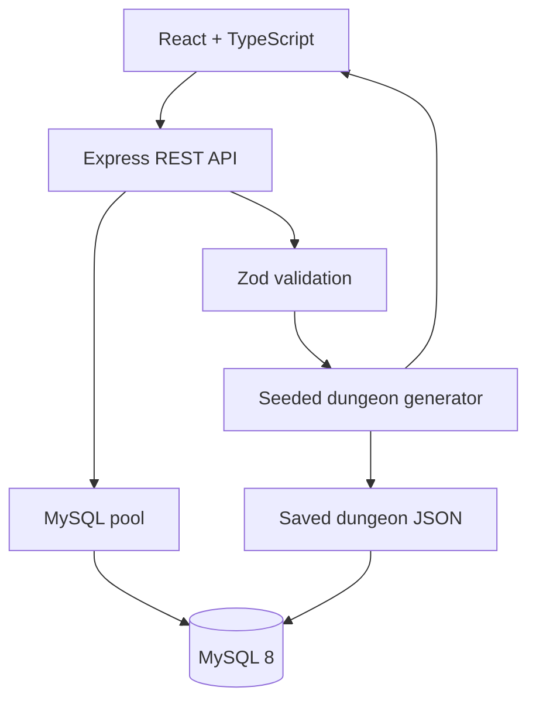

# Architecture

The browser is untrusted; request bodies are validated server-side. SQL uses placeholders. Secrets are read from environment variables and `.env` is gitignored. CORS is restricted to `CLIENT_ORIGIN`.
